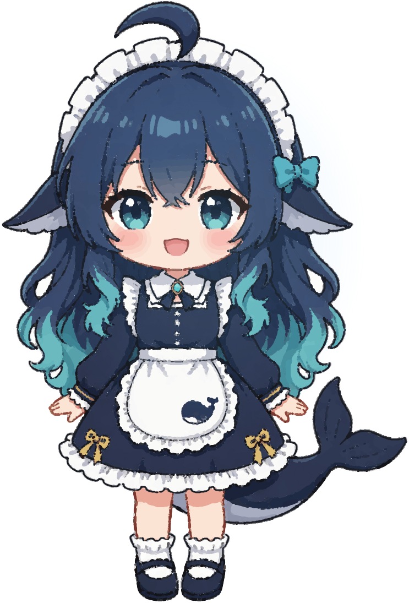

# css-whale-girl

[English](README.md) · **中文**

**用 7,348 个 `clip-path` 多边形画一张插画。零图片、零 SVG、零 Canvas、零 JavaScript。**



```
文件大小        4.04 MB
绘图节点        7,348 个 <b>
clip-path       7,351 处
@keyframes      12 组
图片 / SVG /
Canvas / JS     全部 0
```

> **关于逐像素误差**：文章里出现过 `9.69`，但我重写测量脚本之后
> **复现不出来**（同一份产物测到 56.55）。所以这个数字不写在这里。
>
> 仓库带了一个可复现的测量脚本，你可以自己测 —— 具体经过见
> [`docs/failures.md`](docs/failures.md) 第九条。
>
> 一个仓库说「误差是 X」而别人测出来不是 X，比不说更糟。

---

## 这是什么

一条把位图描摹成**纯 HTML + CSS** 的管线。输入一张插画，输出一个单文件
HTML —— 打开就长成那张画，没有任何外部依赖。

和社区的同类项目（[image-to-css-art](https://github.com/AvroraCL/image-to-css-art)、
[img2css](https://github.com/javierbyte/img2css)）相比，这条路线的三个不同选择：

| 选择 | 我们的做法 | 为什么 |
|---|---|---|
| **不用局部渐变** | 每个多边形一个纯色 | 测过：套渐变之后误差反而**变大**，11.03 → 18.65 |
| **孔洞不用桥接** | 按深度排序，让更深的层盖住 | 不算桥，代价是层数变多 |
| **加残差补偿层** | 误差最大的那批像素再聚类一次 | 嘴巴、眼高光、蕾丝孔洞全靠它捞回来 |

详细对比见 [`docs/alternatives.md`](docs/alternatives.md)。

---

## 管线

```
参考图
  → K-means 颜色量化（K≈72）
  → 每个颜色区域用 marching squares 提亚像素轮廓
  → 弧长重采样 + 周期高斯平滑
  → Douglas-Peucker 简化
  → 深度排序（painter's algorithm）
  → [可选] 描边层：把 lineart 单独提一层
  → [可选] 残差层：误差最大的像素再聚类
  → 输出 <b class="rN"></b> + clip-path: polygon(...)
```

坐标全部用百分比，所以能任意缩放。

每一步的参数取舍、以及**为什么这么选**，见 [`docs/pipeline.md`](docs/pipeline.md)。

---

## 用法

```bash
pip install -r requirements.txt

python src/trace.py 参考图.png       # 量化 + 描轮廓
python src/inkfix.py                 # （可选）描边层
python src/residual.py               # （可选）残差补偿
python src/build_site.py data/layers_res3.json art/output.html
python measure/remeasure_mae.py --ref 参考图.png
```

数据目录默认 `data/`，可用环境变量 `CWG_DATA` 覆盖。
**查看阶段什么都不需要** —— 生成的 HTML 双击就能开。

---

## 为什么单独有个测量脚本

这个项目的两天时间浪费在**测量脚本本身是错的**：

1. `Image.transform` 参数写反 → 误差虚高到 105
2. 参考图白底、渲染图深底 → 虚高到 147
3. 页面 100% 宽再缩回目标尺寸 → 缩放模糊被算进「绘制误差」

修完之后口径才固定：

```
页面设成参考图的原生尺寸（743×1095），角色 1:1 铺满、不做任何缩放，
截完图直接逐像素比。
```

**改管线之前先跑它拿到基线，改完再跑一次。** 不要凭肉眼判断 ——
我们试过，肉眼几乎看不出差别的十二张图，当时的坏尺子说它们差了 2.8 倍。

完整翻车记录见 [`docs/failures.md`](docs/failures.md)。

---

## 参考图从哪来

管线需要一张参考图才能跑。**仓库里带了一份：[`docs/reference.png`](docs/reference.png)**，来源如下：

| 步骤 | 内容 |
|---|---|
| 1. 原始素材 | 社区流传的一张 **143×198** 像素精灵图。分辨率太低，放大只会得到糊色块 |
| 2. AI 重绘 | 用**图生图**把它重绘成 **864×1152** 的线稿 —— 这是「重新画了一遍」，不是插值放大。蕾丝扇贝、鲸鱼绣样、金色蝴蝶结、发丝分缕是这一步补出来的 |
| 3. 生成工具 | [Agnes AI](https://apihub.agnes-ai.com) 的图片接口（`agnes-image-2.1-flash` / `2.5-flash` / `2.0-flash`），通过 DeepSeek Harness 的 `agnes-image` skill 调用 |
| 4. 裁剪 | 864×1152 裁掉留白 → **743×1095**，也就是所有测量用的尺寸 |

**为什么第 2 步不能省**：自动轮廓追踪只能描出图里已有的东西。
143×198 里根本没有蕾丝扇贝的细节，描出来只会是一团色块。

---

## 目录

```
src/          管线（Python，只在生成时用）
measure/      可复现的逐像素测量
art/          成品 HTML（CC BY-NC-SA，见下）
docs/
  pipeline.md     每一步的参数与取舍
  failures.md     走错的路（这个仓库最重要的文件）
  alternatives.md 和社区同类项目的技术对比
```

---

## 许可证

- **代码**（`src/`、`measure/`）：[MIT](LICENSE)
- **插画成品**（`art/`）：[CC BY-NC-SA 4.0](LICENSE-ART)
- **参考图**（`docs/reference.png`）随仓库提供，仅供对照

角色「鲸鱼娘」是**社区共同创作的二创形象**，不是 DeepSeek 官方角色：

1. 最深一层是 DeepSeek 官方标志里那条**虎鲸**
2. 中间一层是社区和 B 站几位 UP 主建立的拟人形象
3. 最外一层才是这个仓库做的事情 —— 用一种新的方式把它重新画了一遍

所以插画资产用 CC BY-NC-SA：开放、非商用、相同方式共享。

---

## 这个仓库不包含

- 视频管线（69 秒短片、字幕、配乐）
- 文章排版转换器
- 部署脚本

那些和「画这张图」无关，放进来只会让这个仓库变重。
